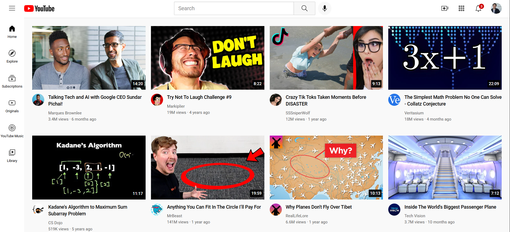

# YouTube Clone
**YouTube Clone**:  A front-end web development project that recreates the YouTube interface using **HTML and CSS**. It features a navigation bar, sidebar, video thumbnails, channel details, and a responsive video grid layout, helping demonstrate core web design and layout concepts.

A front-end recreation of YouTube's video browsing interface, built using **HTML5 and CSS3**.

This project focuses on recreating YouTube's familiar layout, including its navigation bar, sidebar, and responsive video grid.

## 📸 Project Preview



## ✨ Features

- Responsive video grid layout.
- YouTube-style header with search bar and navigation icons.
- Sidebar navigation menu.
- Video thumbnails with duration labels.
- Channel profile pictures and video information.
- Organized and reusable CSS styling.

## 🛠️ Technologies Used

- HTML5
- CSS3
- CSS Grid
- Flexbox
- Media Queries
- CSS Positioning

## 📂 Project Structure

```text
youtube_clone/
│
├── youtube.html
│
├── styles/
│   ├── general.css
│   ├── header.css
│   ├── sidebar.css
│   └── video.css
│
├── thumbnails/
├── channel-pictures/
│
├── assets/
│   └── youtube-clone-preview.png
│
└── README.md
```

## 🚀 Getting Started

1. Clone this repository:

   ```bash
   git clone <your-repository-url>
   ```

2. Open the project folder in VS Code.
3. Open `youtube.html` in your browser.

You can also use the Live Server extension in VS Code to preview the project.

## 📚 Concepts Practised

- HTML page structure and elements.
- CSS Grid for video layouts.
- Flexbox for navigation and alignment.
- Relative, absolute, and fixed positioning.
- Responsive layouts using media queries.
- Organizing CSS into separate files.

## 🔮 Future Improvements

- Add functional search using JavaScript.
- Implement video playback.
- Add interactive navigation.
- Improve mobile responsiveness.

## ⚠️ Disclaimer

This project is created for educational purposes and is inspired by YouTube's user interface. It is not affiliated with or endorsed by YouTube or Google.
